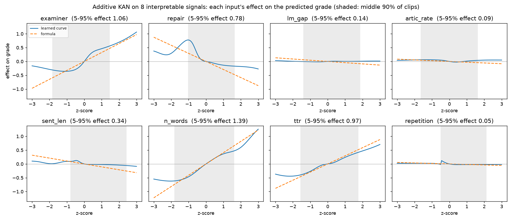

# Grammar Scoring Engine

**Predicting a human grammar rating (1–5, half-point steps) from a 45–60 second recording of spoken English.**
Built for the Kaggle competition *SHL Hiring Assessment 2026* by **Amrita (Kaggle: ambruhsia)**.

This repository leads with all my ideas and approaches that i came up during this compedition. The scoring system around them combines techniques adopted from other
participants' public write-ups (credited where they appear) with methods developed in the project's experiment loop.

| | out-of-fold RMSE (speaker-grouped, weighted to the test's mix) | public leaderboard |
|---|---|---|
| Starting point: the original notebook (v18) | 0.475 on random folds (optimistic, see below) | 0.3770, rank ~90 / 425 |
| **Final pick 1, `hybrid11`**: two pipelines × 4 fold-seed sets, examiner correction | **0.5013** | **0.3279** |
| Final pick 2, `pubmix_c`: hybrid11 shifted by −0.041 (a public-board bias estimate) | — (a test-time offset; CV can't judge it) | 0.3271 |
| Best public score of the project | — | 0.3264, rank ~22 / 449 (20 Oct 2026) |

Other numbers for pick 1 (out of fold): Pearson 0.875, MAE 0.377, QWK 0.856, 72.7% of clips within half a point and 94.8%
within one point. Board metric at the test's batch mix 0.358; its 95% interval on 130-clip resamples is 0.306–0.420,
and the public 0.3279 sits inside it.

> **Why the two columns look so different.** The leaderboard scores 0.6 × RMSE + 0.4 × (1 − Pearson), on about 130
> clips. The CV column is a plain RMSE on 732 clips, with folds that never split a speaker and weights that make the
> short recordings (68% of test, 24% of train) count as much as they will on test. It's pessimistic on purpose. Adding a
> clip-level leak made the old random-fold CV look 0.02 better while the leaderboard got worse.

## Ideas

Full detail, with every number: [docs/IDEAS.md](docs/IDEAS.md).

1. **Read the model through its effect on people.**
   - Report cards built only from explainable features.
   - An accent-exposure analysis: the recognisers' repair rate partly measures how *recognisable* speech is, not just its
     grammar.
   - An openly stated halo effect: a speech model that never sees the words predicts the grammar rating better than one
     reading them.
2. **Stay faithful to the rubric.**
   - Restarts were excluded as "self-correction", because they went with *lower* grades while the rubric rewards repair.
   - A label-free test asked whether short recordings are really weaker. Test-short clips behave like train-short ones,
     so the batch prior stayed.
3. **Laya, a rubric-conditioned decision model.** Eight yes/no checklist questions per sentence earned a place in the
   final model: CV 0.0024 better, held on fresh fold seeds.
4. **Convert the audio into embeddings that more model families can use.**
   - The largest honest CV gain of the final week: better on all four fold-seed sets and on unseen prompts.
   - It then lost about 0.003 on the board. The cause, found without labels, is that test short clips are different,
     noisier recordings, and the raw embeddings carry that shift.
5. **Kolmogorov–Arnold networks and symbolic regression**, tested in four roles. One is an interpretable model in which
   every signal's effect is a readable curve (below). Another is a single additive KAN that matches the whole 24-member
   stack on familiar prompts.
6. **Set the agenda and hold the line.**
   - A research brief aimed at the weak spots: short clips, unseen prompts, compressed extremes, speech-recognition
     failures.
   - Licence checks that excluded both external corpora.
   - Challenging a summary claim until it was measured.
   - Final picks chosen to fail differently.



## The system in brief

**The two recognisers.** Each answer is transcribed twice: by Whisper, which writes clean text, and by a CTC model without
a language model, which keeps the speaker's words as spoken. The gap between the two measures how much grammar was
repaired. This idea comes from other participants' public write-ups.

**The members** that feed a two-level stack:
- speech-encoder heads;
- DeBERTa models on the (raw, clean) transcript pair;
- Qwen hidden-state heads;
- a Voxtral audio-LLM head (Voxtral as a view also comes from the top write-ups);
- a Rank-N-Contrast embedding;
- Amrita's Laya checklist features.

**Correction.** A zero-shot Qwen3.5-9B examiner, the rubric-judge idea of the #1 write-up, corrects the stack's residual
inside the folds. In a clean A/B that was worth 0.0055 on the board.

**Validation.** Speaker twins and two recording batches were reported by other participants. The validation built on them
does four things:
- never splits a speaker across folds;
- weights each recording batch to its share of test;
- checks unseen prompts after every stage;
- decides with pre-set rules and a paired speaker-group bootstrap.

That scheme exposed a column that had memorised voices. Removing it made CV 0.02 worse and the board 0.007 *better*.

**The final picks** average two pipelines on short clips and bag over four fold-seed sets.
[docs/APPROACH.md](docs/APPROACH.md) describes the system and [docs/VALIDATION.md](docs/VALIDATION.md) the measurement.

## Where to read more

| document | what's in it |
|---|---|
| [docs/IDEAS.md](docs/IDEAS.md) | **my ideas**, one by one; then the credited sources of everything else |
| [docs/APPROACH.md](docs/APPROACH.md) | The final system and the approaches that are unusual for this task |
| [docs/VALIDATION.md](docs/VALIDATION.md) | How results were measured and decided, and why the leaderboard wasn't the yardstick |
| [docs/WHAT_FAILED.md](docs/WHAT_FAILED.md) | About 60 things that didn't work, with numbers and the lesson from each |
| [docs/RESULTS.md](docs/RESULTS.md) | The score timeline, from 0.3770 to 0.3264, and the final picks |
| [docs/REPRODUCING.md](docs/REPRODUCING.md) | How to run it: GPU jobs, the local loop, the final notebook |
| [docs/EXPERIMENT_LOG.md](docs/EXPERIMENT_LOG.md) | The full lab notebook, 198 runs in order, mistakes and corrections included |

## Repository map

```
kaggle/main/      the original Kaggle notebook: two ASR passes, handcrafted + grammar-aware features, speech encoders,
                  DeBERTa, 9 model families, report cards and findings
kaggle/final/     the final submission notebook: replays the 8 runs behind hybrid11 from their saved candidate matrices
kaggle/<job>/     22 Kaggle jobs (21 GPU, 1 CPU): grouped DeBERTa, Qwen2.5 / Qwen3.5 / Phi-4 examiners, Voxtral, verbatim ASR, Laya, ...
src/              the local experiment loop: run.py (one experiment = one flag), stacking, validation, every member built on CPU
scripts/          Kaggle helpers: pull the notebook's outputs, guarded submission, scores, GPU jobs
reports/          figures and aggregate tables (validation, rubric checks, error analysis, the KAN curves)
experiments.csv   the run ledger: every experiment's description, CV per seed and verdict
```

## How this was built

I built the original model in a Kaggle notebook (versions 1–18), set the research directions and constraints,
proposed the ideas in [docs/IDEAS.md](docs/IDEAS.md), and made the calls on what to keep and submit. The experiments
followed fixed guard rails:
- one change per experiment, kept only if a fixed CV rule accepts it;
- every result logged;
- GPU jobs and submissions only with her approval.

Techniques adopted from other participants' public write-ups are credited in
[docs/IDEAS.md](docs/IDEAS.md#where-the-rest-came-from). In total: 198 logged runs, 22 Kaggle jobs and 57 board submissions
over three weeks.

## Data and licences

**No competition data is in this repository**: no audio, labels, transcripts, features or predictions. Get the data from
the competition page on Kaggle, under its rules. A few job sources embedded per-clip tables when they ran; the public copies
say where those were removed.

Every model used allows commercial use; the competition required it. Whisper and Whisper-large-v3-turbo (MIT), wav2vec2-large-robust
(Apache-2.0), WavLM (CC BY-SA 3.0), DeBERTa-v3 (MIT), Qwen2.5-7B and Qwen3.5-9B (Apache-2.0), Voxtral-Mini-3B (Apache-2.0),
Phi-4 (MIT), Laya (Apache-2.0), all-mpnet-base-v2 (Apache-2.0), SpeechBrain SepFormer DNS-4 (Apache-2.0), spaCy (MIT). The
CoLA classifier's model card states no licence; [kaggle/final](kaggle/final) lists every stage. No external training data
was used: the two corpora considered (Speak & Improve, ICNALE) don't allow commercial use.

Code: MIT ([LICENSE](LICENSE)).
