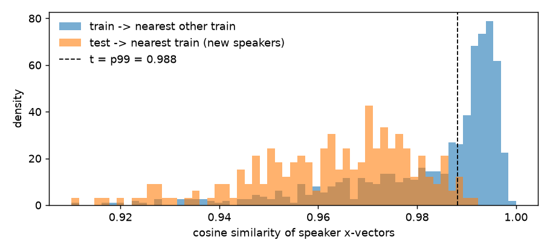

# The final system, and what's unusual about it

## The data and its three traps

There are 769 training and 216 test recordings, each 45–60 s of spoken English, graded 1–5 in half points. 37 training
clips labelled 0 are static noise, a sentinel; no test clip resembles them (spectral flatness check). They're dropped,
leaving **732 labelled clips**. Almost every grade is between 2.0 and 5.0; only four clips are below 2.0.

Three properties of the data decide most of what follows:

1. **Speaker twins.** Clustering voice embeddings (x-vectors) finds 503 speakers. **53% of training clips share a speaker
   with another training clip**, usually with adjacent file ids. Twins' grades differ by 0.24 on average, against 1.16 for
   random pairs, so random cross-validation folds leak the grade through the voice. Test speakers are all new.
2. **Recording batches.** Clips shorter than 47.7 s are **24% of train but 68% of test**. They include an exact-45.06 s batch
   that makes up 39% of test. The batches differ in *recording*, not only in length: even on equal-length 30 s crops, a
   classifier tells them apart with AUC 0.93–0.95. Test short clips are noisier still than training short clips (SNR 37
   against 42 dB).
3. **Prompt shift.** Ten prompt topics (k-means on the transcript embeddings). One, "floods", is 10% of test and has *no*
   training clips; another is 30% of test but 3% of train.



## Inputs

```
audio ─┬─ Whisper (clean text, timings) ─┐
       ├─ CTC wav2vec2 (raw words) ───────┼─ repair_wer, 21 handcrafted features, GPT-2 surprise gap, CoLA, Laya checklist
       ├─ Whisper-large-v3-turbo verbatim ┘   (the transcript PAIR feeds every fine-tuned text model)
       ├─ frozen speech encoders: WavLM-base-plus, WavLM-large, Whisper-medium → ridge / SVR heads
       ├─ Voxtral-Mini-3B audio LLM: hidden states, grammar question after or before the audio (3 views)
       └─ x-vectors → speaker groups (validation, label denoising, pooling)
transcripts ─┬─ DeBERTa-v3: Whisper text; (CTC raw, Whisper clean) pair, base and large ×6 seeds; (verbatim, clean) pair
             ├─ Qwen2.5-7B rubric-prompt hidden states, Qwen3.5-9B answer-state heads (3 transcripts)
             ├─ Rank-N-Contrast embedding (grade-ordered, speaker- and topic-crossing positives)
             └─ Qwen3.5-9B zero-shot examiner: rubric, accuracy, complexity, completeness and CEFR questions → 21 numbers
                (used only to correct the stack, see below)
```

## Stacking

Each of the two pipelines does the following, inside speaker-grouped folds:

1. **Nine model families**: ridge, kernel ridge, SVR, kNN, random forest, extra trees, MLP, LightGBM and XGBoost. They learn
   from the features plus every member's out-of-fold prediction. Members are fitted on *denoised* targets: half the
   clip's grade, half its speaker group's mean grade.
2. **Blend, per recording batch.** Non-negative least squares on the candidates, fitted separately for short and long clips.
   The weights are fitted on *topic-held-out* predictions, so they favour members that generalise to new prompts. They're
   refit inside every fold, so the blend's own out-of-fold score is honest. The short-batch fit also sees long clips at
   weight 0.25.
3. **Examiner correction** (combination pipeline only). A ridge on [21 examiner numbers, the prediction] predicts the
   residual, refit inside every fold.
4. **Same-speaker pooling** (combination only): p' = 0.7·p + 0.3·(mean of p over the clip's same-voice group). In test,
   41 of 216 clips sit in 17 voice groups.

The two pipelines:
- **Base:** the leak-free version of the original notebook's stack, plus Voxtral and the Laya checklist.
- **Combination:** base, plus Rank-N-Contrast, an RBF-SVR head on WavLM-large layer 20, DeBERTa-v3-large on the pair (6
  seeds, replacing the base pair model), DeBERTa on the verbatim pair, Qwen3.5 heads, 3-view Voxtral, the shrunk short
  blend, the examiner correction and pooling.

**Final prediction (`hybrid11`):**
- Short clips: the mean of the two pipelines.
- Long clips: the combination alone.
- Each pipeline is averaged over four fold-seed sets (42/1337/2024, 7/99/555, 11/22/33, 44/66/88).
- Clipped to [1.5, 5.0].

| | cv_testmix | short | long |
|---|---|---|---|
| base pipeline (4 seed sets) | 0.5127 | 0.5155 | 0.5067 |
| combination pipeline (4 seed sets) | 0.5013 | 0.5081 | 0.4865 |
| **hybrid11** | **0.5013** | 0.5082 | 0.4865 |

On CV the hybrid and the combination tie. On the public board the hybrid wins by 0.006 (0.3279 against 0.3338). Fresh fold
seeds had shown the combination's gain sits entirely on long clips, which is why short clips average both pipelines. The
public-board result confirmed it after the fact.

## What's unusual, and the evidence for it

### 1. Two recognisers, one grammar signal
Amrita's founding design: see [IDEAS.md](IDEAS.md#1-transcribe-twice-read-grammar-from-the-gap). The Whisper-versus-CTC gap
measures how much grammar Whisper repaired. Every text model since reads the *pair*, so it can tell a speaker's error
from a misrecognition.

### 2. Validation that mirrors the test set
- Speaker-grouped folds, test-mix weighting, an unseen-prompt check, fresh fold seeds;
- decisions made with pre-set rules and a paired speaker-group bootstrap.

The scheme found a member that had been memorising voices. It also showed that most of the gains measured on random folds
were partly leakage. Full detail in [VALIDATION.md](VALIDATION.md).

### 3. An LLM examiner as a residual corrector, not a member
- **The examiner.** A zero-shot Qwen3.5-9B (4-bit, one forward pass per question, no generation) answers rubric questions
  about three transcripts. The probability-weighted answer correlates up to +0.73 with the human grade.
- **As a blend member it fails.** The blend's weights must be non-negative, and the examiner is collinear with the members
  (CV 0.5097 against 0.5088).
- **As a residual stage it works.** It only has to explain what the stack gets wrong: given the stack's prediction, its
  numbers still correlate with the grade on short clips (partial r +0.07 to +0.17, and up to +0.31 on the 45.06 s batch),
  against 0.00–0.04 on long ones.
- **A clean A/B with matched bagging:** with the correction public 0.3280, without it 0.3335.
- **A variant that failed.** Giving the examiner its own slope on the 45.06 s batch produced the best CV of the project
  (0.4994) and a *worse* public score (0.3311). With 86 training clips, the slope learned those clips' prompts, not their
  recordings. The examiner's *grade* generalises; a batch-specific *slope* doesn't.

### 4. Per-recording-batch stacking
- Text members carry the short batch; audio members and trees carry the long one. One shared blend can't serve both.
- Splitting the blend by batch was the largest single CV gain of the stacking work (0.5139 → 0.4992).
- A third group for the 45.06 s batch, as one public write-up used, added nothing here.

### 5. Two pipelines, averaged where they disagree
- **The finding.** On fresh fold seeds, the combination's gain over the base was entirely on long clips. Its apparent
  short-clip gain on the main seeds was fold luck.
- **The fix.** Averaging the two pipelines on short clips was robust on both fold-seed sets.
- **Public score:** 0.3344 (base) → 0.3309 (first hybrid) → 0.3279 (with the shrunk blend and bagging).
- Averaging the *pipelines* beat both alone (0.3334 and 0.3338).

### 6. Speakers used three ways
The same x-vector clusters serve three jobs:
- **Fold groups**, so twins never straddle a split.
- **Label denoising:** members learn from a mix of the clip's grade and its speaker's mean grade. It's safe because
  groups never straddle a split.
- **Test-time pooling:** a clip's prediction is pulled toward its same-voice neighbours.

### 7. Rank-N-Contrast: a grade-ordered embedding that ignores speaker and topic
- A small network maps the text and audio embeddings to a space where distance follows the grade.
- Its positive pairs are chosen from a *different speaker and a different topic*, so it can't cluster by voice or prompt.
- When introduced it was the strongest learned member (0.541). It's in the combination pipeline.

### 8. Asking the audio LLM the question first
- Voxtral reads the audio and a grammar question. Putting the question *before* the audio gives better hidden states for
  grading.
- Averaging three views (question after; question before, in two wordings) gave the best single member: 0.5315.

### 9. Reading the public board without fitting to it
Following other teams' public write-ups, the board metric was decoded as 0.6 × RMSE + 0.4 × (1 − Pearson). Two
shift probes (a submission shifted by −0.25 and by −0.50) then gave:
- public RMSE 0.488, Pearson 0.879, and a bias of only +0.049;
- so calibration was not the gap to the top.

A predictor built from those probes reproduces unseen public scores to within 0.0004. It was used for one thing only: the
bias offset in pick 2. It was never used to choose a model.

### 10. A model that explains itself
An additive Kolmogorov–Arnold network on eight understandable signals shows each signal's effect as a curve
([reports/kan](../reports/kan)):
- **Accuracy:** the curves cost 0.20 against the full stack, so the stack's accuracy comes from learned representations,
  not these signals.
- **Shape:** the curves show the examiner's floor, the repair-rate penalty, and a large "amount said" effect that is
  partly recording length.
- **The finding:** one additive KAN on the *stack's* inputs (the members' predictions included) matches the 24-member blend
  on familiar prompts. It does worse on unseen prompts.

### 11. A notebook that replays the result exactly
- **What it replays:** the final notebook ([kaggle/final](../kaggle/final)) re-runs the stacking of all eight runs behind
  `hybrid11` from their saved candidate matrices. It checks each against the run's files (max difference ≤ 3.6e-15) and
  writes both picks.
- **Speed:** about 40 s on a CPU.
- **The GPU stages** (transcription, encoders, fine-tunes, examiners) are ported into an appendix behind a flag.
- **Training RMSE 0.4800**, a figure the brief requires. It's computed with every stacking stage fitted on all 732 clips and
  the members entering as their out-of-fold predictions, so it measures the stacking's fit, not memorisation.
